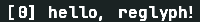

# reglyph



## what it is?
a small, GUI-based editor, focused on simplicity

### why?

I noticed that there are little open source editors which will not be over-complicated, so

## position
In between a text editor and an IDE, smaller than VS Code, but more than sublime/minimalist text editors

## status

currently v0.0.6:
- able to parse args/file names (args only, doesn't open files)
- able to create a window
- able to draw rectangles 
- primitive layout
- Text!
- basic input!
- append only editing

## planned:

- better graphics
- file tree
- full text editor
- simple extension platform
- simple lsp support
- word wrap
- save and load

## reqs

requires:
- c++ compiler (compliant to ISO C++ 20 and ISO C++ 20 stdlib)
- glfw
- opengl
- ft2 (freetype2)
- harfbuzz (soon will be used)

```bash 
git clone https://github.com/TheStaticNoise/reglyph.git
cd reglyph/src
make
```

run:
from src/
```bash
./reglyph
```

## indexing 

0 indexing for life, so even lines in reglyph are counted from 0 XD

## known quirks
those are known quirks:
- a bit of the font becoming more bold up to some limit after typing in a new line
- ascii only
- a bit imprecise gutter
- no saving/loading

## AI usage disclosure

as per YSWS requirements, here's the AI disclosure:
AI was used for information, parts of implementation, and debugging, 
but, most of the implementation was hand written.

## license

MIT license, 
Copyright (c) 2026 static_noise. 
